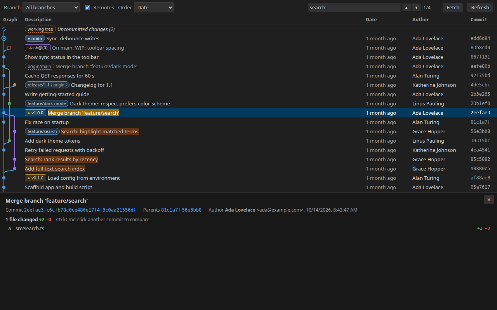

# Mergeline: Git Graph, History & Branch Actions

**See your branches as a graph, then act on them from it.** Mergeline is a free, open-source
(MIT) commit graph for VS Code, VSCodium, Cursor and Windsurf. You can check out, merge,
rebase, cherry-pick, revert, reset, tag, push and stash right from the graph. It needs no
account, has no paid tier and sends no telemetry.

## Open it

- Click **Graph** in the status bar,
- or the Mergeline button in the **Source Control** title bar,
- or run **Mergeline: Show Commit Graph** from the Command Palette.

## Features

- **Graph**: coloured lanes, merge commits, local and remote branches (a local branch and its remote twin share one badge), tags, the current branch and detached HEAD, **stashes**, and an **uncommitted changes** row.
- **Table**: graph, description, date, author and hash columns, with a header that stays visible when you scroll. Drag a column edge to resize it (double-click resets it), and right-click the header to hide or show columns. Your layout is kept across sessions.
- **Fast**: only visible rows are rendered. The first 500 commits load at once and more load as you scroll. On a 100,000-commit repository the first page is ready in about 0.35 s.
- **Details**: click a commit to see its full message, author, committer, parents and changed files with +/− counts and renames. Click a file to open it in VS Code's diff editor. Right-click a file to open it, open it as it was at that commit, compare that version with your working copy, show its history, reveal it in the Explorer or copy its path. Links in commit messages are clickable, and so are `#123` issue references and the **Open on GitHub** link (also GitLab and Bitbucket) when your remote is hosted there. Drag the bar above the pane to resize it.
- **Compare**: Ctrl/Cmd-click a second commit to see every file that changed between the two. Right-click a commit → **Compare with working tree**, or a branch → **Compare with** the current branch.
- **Find**: Ctrl/Cmd+F searches subjects, authors, emails, hashes and ref names. Press Enter or Shift+Enter to step through matches. **All history** (or Enter when nothing loaded matches) searches every commit the graph can show, not just the loaded ones (`git log --grep` / `--author`, hash prefix, ref names), and loads as far as needed to show the match.
- **File history**: right-click a file (Explorer, editor tab or editor) → **Show File History in Mergeline** to see only the commits that touched it, still drawn as a connected graph. Renamed or moved files are followed back through their old names (shown in the bar above the graph).
- **Filter**: show one branch, or hide remote branches.
- **Order**: date, topology or author date. Topology keeps each branch's commits together, which makes busy histories much narrower.
- **Keyboard**: ↑/↓, Page Up/Down and Home/End move between commits, Ctrl/Cmd+F finds, Esc closes the details pane.

### Right-click actions

| On | Actions |
|---|---|
| Commit | Create branch here · Add tag (lightweight or annotated) · Check out (detached) · Cherry-pick · Revert · Merge into current branch (fast-forward, `--no-ff` or `--squash`) · Rebase current branch onto it · Interactive rebase from here (in a terminal) · Reset current branch to it (soft, mixed or hard) · Compare with working tree · Open on GitHub/GitLab/Bitbucket · Copy hash or subject |
| Branch | Check out · Merge · Rebase onto · Compare with current branch · Push (sets upstream) · Pull · Rename · Delete (asks before force-deleting an unmerged branch) · Copy name |
| Remote branch | Check out as a local tracking branch · Merge · Rebase onto · Compare with current branch · Open on GitHub/GitLab/Bitbucket · Delete on remote · Copy name |
| Tag | Push · Merge · Delete locally or also on the remote · Copy name |
| Stash | Apply · Pop · Create branch from stash · Drop |
| File (details pane) | Open changes · Open file · Open file at this commit · Compare with working tree · Show file history · Reveal in Explorer · Copy relative or absolute path |
| Uncommitted changes | Stash (including untracked files) · Open Source Control · Discard all |

Destructive actions (hard reset, force delete, deleting on a remote, drop, discard) always ask
first, in a modal dialog. For a merge commit, cherry-pick and revert ask which parent is the mainline.
Push, pull and fetch go through VS Code's built-in Git, so your usual credential prompts work.

## Settings

| Setting | Default | |
|---|---|---|
| `mergeline.initialCommits` | 500 | Commits to load first, and on each "load more". |
| `mergeline.showRemoteBranches` | true | Show remote-tracking branches. |
| `mergeline.showStashes` | true | Show stashes as graph nodes. |
| `mergeline.showUncommitted` | true | Show the uncommitted-changes row. |
| `mergeline.commitOrder` | date | `date`, `topo` or `author-date`. Also in the toolbar. |
| `mergeline.statusBarButton` | true | Show the status-bar button. |
| `mergeline.dateFormat` | relative | `relative`, `iso` or `locale`. |

## Why Mergeline

- **Maintained.** It is built against current VS Code and has an end-to-end test suite that drives every core action in a real VS Code instance.
- **Free, with nothing paywalled.** The graph and every action are free. There is no account and no "Pro" tier.
- **Open source and forkable.** MIT licence. You can fork it, fix it and publish your fork.
- **Everywhere.** The end-to-end suite passes in VS Code and in VSCodium. It uses only the standard extension API, which Cursor and Windsurf also provide, and it runs git wherever your workspace is, so remote (SSH, WSL, container) sessions work the same way.
- **Private.** Mergeline makes no network requests of its own. Fetch and push talk only to your own remotes, and only when you ask. Web links (Open on GitHub, issue numbers) open in your browser only when you click them.

## Requirements

`git` must be on your `PATH`. The workspace must be trusted, because Mergeline runs git commands.

## Feedback

Bugs and ideas: [GitHub issues](https://github.com/janwan2003/vscode-commit-graph/issues).
Website: <https://janwan2003.github.io/vscode-commit-graph/>.

## About

Mergeline is a free, open-source git graph extension by Plainbyte. MIT licensed.
