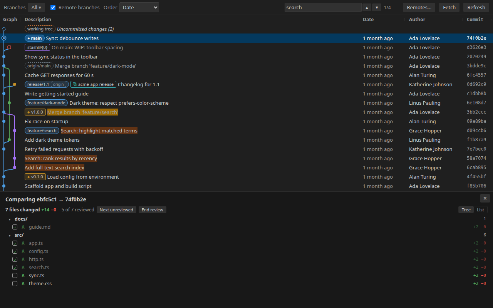
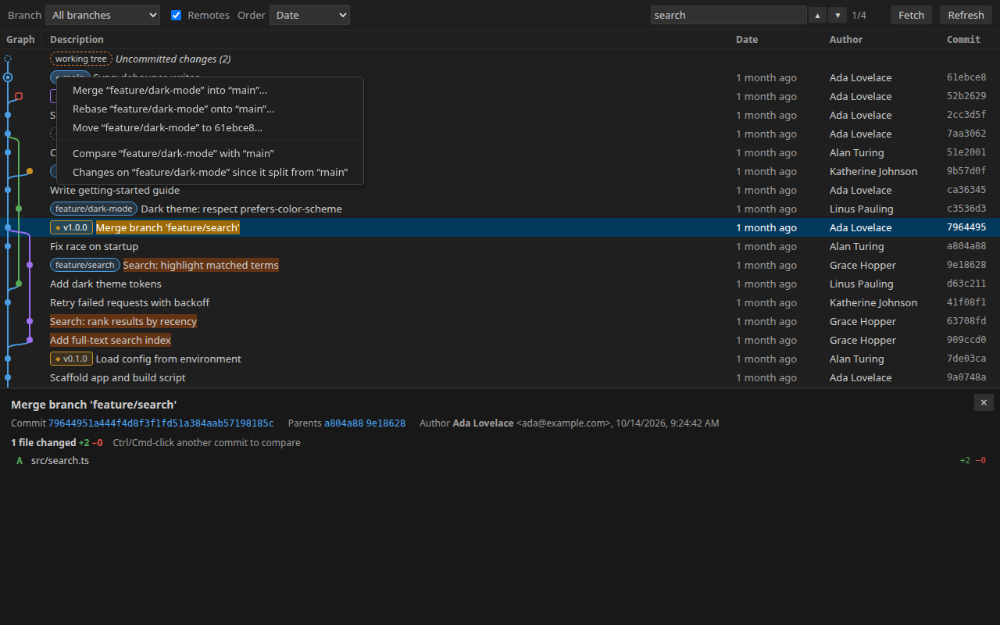
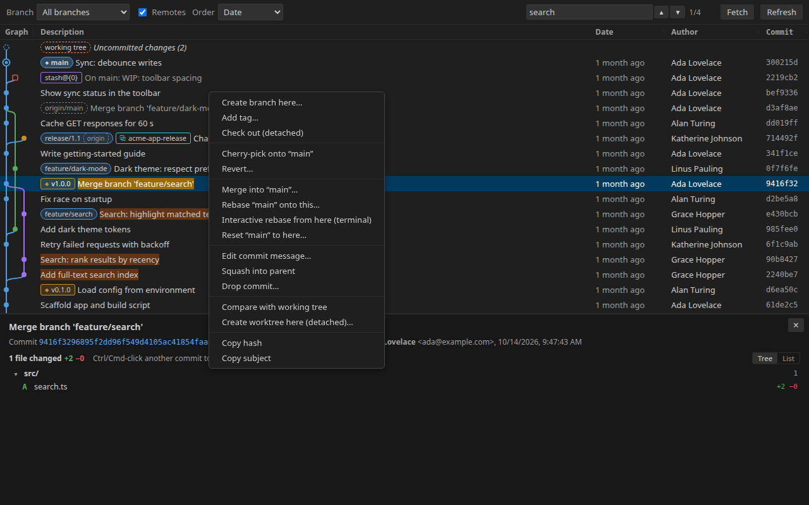
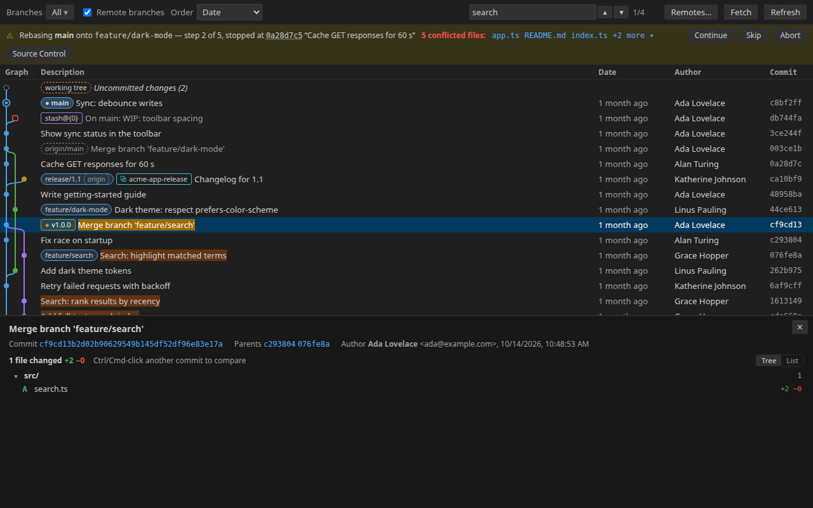
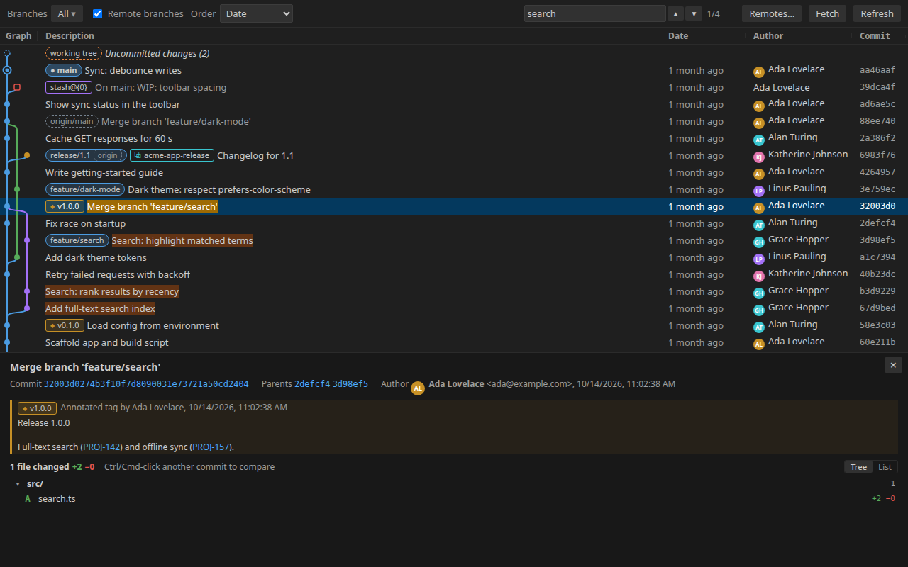
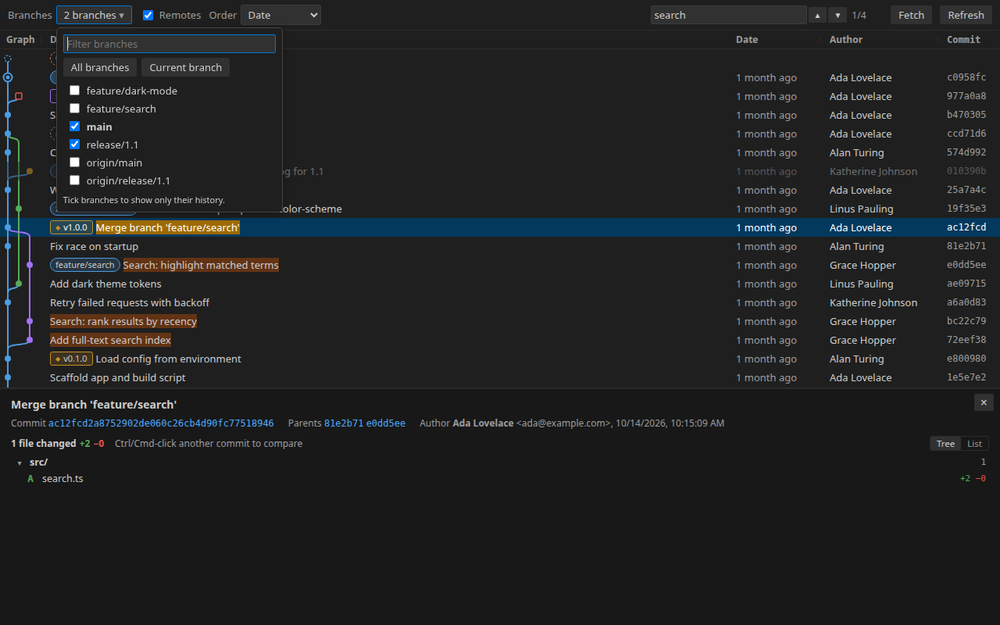

# Mergeline: Git Graph, History & Branch Actions

**See your branches as a graph, then act on them from it.** Mergeline is a free, open-source
(MIT) commit graph for VS Code, VSCodium, Cursor and Windsurf. You can check out, merge,
rebase, cherry-pick, revert, reset, tag, push and stash right from the graph. It needs no
account, has no paid tier and sends no telemetry.


## Open it

- Click **Graph** in the status bar,
- or the Mergeline button in the **Source Control** title bar,
- or run **Mergeline: Show Commit Graph** from the Command Palette.

## Features

- **Graph**: coloured lanes, merge commits, local and remote branches (a local branch and its remote twin share one badge), tags, the current branch and detached HEAD, **stashes**, and an **uncommitted changes** row. A branch that tracks a remote branch shows how far apart they are: **↑2** commits to push, **↓3** to pull (as of the last fetch), **✕** when its upstream was deleted on the remote.
- **Table**: graph, description, date, author and hash columns, with a header that stays visible when you scroll. Drag a column edge to resize it (double-click resets it), and right-click the header to hide or show columns. Your layout is kept across sessions.
- **Fast**: only visible rows are rendered. The first 500 commits load at once and more load as you scroll. On a 100,000-commit repository the first page is ready in about 0.35 s.
- **Details**: click a commit to see its full message, author, committer, parents and changed files with +/− counts and renames. Files are shown in folders or as a flat list (toggle above them). Click a file to open it in VS Code's diff editor. Right-click a file to open it, open it as it was at that commit, compare that version with your working copy, show its history, reveal it in the Explorer or copy its path. **Signed commits** show their GPG, SSH or X.509 signature status (good, untrusted key, expired, revoked, bad, or could not be checked), verified by git with your own keys. Links in commit messages are clickable, and so are `#123` issue references and the **Open on GitHub** link (also GitLab and Bitbucket) when your remote is hosted there. Drag the bar above the pane to resize it.
- **Review file by file**: click **Review** above a commit's (or a comparison's) changed files, or right-click a commit → **Review changes file by file**. Each file gets a check box, the header counts "3 of 8 reviewed", and **Next unreviewed** opens the next file's diff. Opening a diff ticks the file. Your progress is kept per commit or comparison in the workspace until you click **End review**.

- **Compare**: Ctrl/Cmd-click a second commit to see every file that changed between the two. Right-click a commit → **Compare with working tree**, or a branch → **Compare with** the current branch, or **Changes since it split from** the current branch (three-dot diff from the merge base: what a merge would bring in).
- **Drag and drop**: drag a branch badge onto another branch or a commit to merge it there, rebase it onto it, move the branch to that commit, or compare the two. Drag a commit from another branch onto your current branch to **cherry-pick** it. Nothing runs until you pick an item from the menu that opens on drop, and rebases and moves ask first.


- **Edit history**: right-click a commit on your branch to **edit its message** (subject and body), **move it up or down**, **squash it into its parent**, **drop it**, or **stop at it to change its files** (Continue in the bar adds your staged changes to it). Ctrl/Cmd-click a second commit to **squash the range into one**. **Create a fixup commit** for any commit from your staged changes, then **squash all fixup commits into their targets** in one step (`git rebase --autosquash`, no editor). Or drag a commit onto another one on your branch to **squash it into that commit** or **move it right after it**. No editor or terminal opens, uncommitted changes are stashed and restored, and each change can be undone from the notification. Commits that are already pushed get a warning first, and merges are left alone.

- **Stopped rebase, merge or cherry-pick?** A bar above the graph shows what is in progress, which commit it stopped at and which files conflict (click one to open it in the merge editor), with **Continue**, **Skip**, **Abort** and **Source Control** buttons. It also picks up operations you started in a terminal. Continue never opens an editor.


- **Worktrees**: other worktrees show as a ⧉ badge on the commit they have checked out. Create one from a branch or commit, open it in a new window, or remove it, from the right-click menus.
- **Issue links**: `#123` links to GitHub, GitLab or Bitbucket on its own. For Jira, Linear or any tracker, add rules to `mergeline.issueLinks` and matching keys in commit and tag messages become links:
  ```json
  "mergeline.issueLinks": [{ "pattern": "\\bPROJ-\\d+\\b", "url": "https://yourcompany.atlassian.net/browse/$0" }]
  ```
- **Tags and avatars**: the details pane shows each tag on the commit, with the tagger, date and message of annotated tags. Author avatars are opt-in (`mergeline.showAvatars`); see Settings.

- **Find**: Ctrl/Cmd+F searches subjects, authors, emails, hashes and ref names. Press Enter or Shift+Enter to step through matches. **All history** (or Enter when nothing loaded matches) searches every commit the graph can show, not just the loaded ones (`git log --grep` / `--author`, hash prefix, ref names), and loads as far as needed to show the match. Type `path:` and some text (`path:src/auth`, `path:*.md`) and press Enter to step through every commit that changed a matching file or folder (case-insensitive; a glob when it has `*`, `?` or `[`).
- **File history**: right-click a file (Explorer, editor tab or editor) → **Show File History in Mergeline** to see only the commits that touched it, still drawn as a connected graph. Renamed or moved files are followed back through their old names (shown in the bar above the graph).
- **Filter**: tick the branches you want in the **Branches** checklist (any number, local or remote) to see only their history, or pick **Current branch**. Hide remote branches with one click. The `mergeline.dimOtherCommits` setting fades commits that are not in your branch's history.

- **Order**: date, topology or author date. Topology keeps each branch's commits together, which makes busy histories much narrower.
- **First parent**: tick **First parent** in the toolbar to follow only the first parent of merges (`git log --first-parent`). Each branch shows its own line, and the commits a merge brought in are hidden behind it, so a mainline with hundreds of merged pull requests reads as one list.
- **Remotes**: the **Remotes…** button (or **Mergeline: Manage Remotes**) lists your remotes with their URLs. Add one (and fetch it), or pick one to fetch, fetch and prune, change its URL, rename or remove it, copy its URL or open it on GitHub/GitLab/Bitbucket. Removing says first which remote-tracking branches go and which local branches lose their upstream.
- **Pull requests**: right-click a branch → **Create pull request on GitHub** (or GitLab, Bitbucket) opens the forge's new pull request page for it. Not pushed yet? Mergeline offers to push it first.
- **Keyboard**: ↑/↓, Page Up/Down and Home/End move between commits, Ctrl/Cmd+H jumps to the checked-out commit, Ctrl/Cmd+F finds, Esc closes the details pane.

### Right-click actions

| On | Actions |
|---|---|
| Commit | Create branch here · Add tag (lightweight or annotated) · Check out (detached) · Cherry-pick · Revert · Merge into current branch (fast-forward, `--no-ff` or `--squash`) · Rebase current branch onto it · Interactive rebase from here (in a terminal) · Reset current branch to it (soft, mixed or hard) · On the checked-out branch: Edit commit message (subject and body) · Move commit up / down · Squash into parent · Stop at this commit to change it · Create fixup commit for this · Squash fixup commits into their targets · Drop commit · Squash N commits into one (with a Ctrl/Cmd-click selection) · Review changes file by file · Compare with working tree · Create worktree here (detached) · Open on GitHub/GitLab/Bitbucket · Save as archive (zip, tar.gz, tar) · Copy hash or subject |
| Branch | Check out (or open its worktree, if another worktree has it) · Merge · Rebase onto · Compare with current branch · Changes since it split from the current branch · Check out in new worktree · Push (sets upstream) · Pull · Update from its upstream without checking it out (fast-forward) · Create pull request on GitHub/GitLab/Bitbucket · Rename · Delete (asks before force-deleting an unmerged branch) · Save as archive · Copy name |
| Remote branch | Check out as a local tracking branch · Merge · Fetch and merge into the current branch (pull it, even if you have not fetched lately) · Rebase onto · Compare with current branch · Changes since it split from the current branch · Check out in new worktree · Open on GitHub/GitLab/Bitbucket · Create pull request · Delete on remote · Manage remote · Save as archive · Copy name |
| Tag | Show tag details · Push · Merge · Save as archive · Delete locally or also on the remote · Copy name |
| Stash | Apply · Pop · Create branch from stash · Drop |
| Worktree badge | Open in new window · Copy path · Remove worktree (asks again before discarding uncommitted changes) · Prune missing worktrees |
| Branch dropped on a branch or commit | Merge into it · Rebase onto it · Move the branch there (reset, if current) · Compare · Changes since they split |
| Commit dropped on the current branch or another commit | Cherry-pick onto the current branch (from another branch) · Squash into that commit · Move to right after it (both on your branch) · Compare |
| File (details pane) | Open changes · Mark as reviewed / not reviewed (in review mode) · Open file · Open file at this commit · Compare with working tree · Show file history · Reveal in Explorer · Copy relative or absolute path |
| Remote (**Remotes…** button) | Add remote (and fetch) · Fetch · Fetch and prune · Change URL · Rename · Remove · Copy URL · Open on GitHub/GitLab/Bitbucket |
| Uncommitted changes | Stash (including untracked files) · Open Source Control · Discard all |

Destructive actions (hard reset, force delete, deleting on a remote, drop, discard) always ask
first, in a modal dialog. For a merge commit, cherry-pick and revert ask which parent is the mainline.
Push, pull and fetch go through VS Code's built-in Git, so your usual credential prompts work.

## Settings

| Setting | Default | |
|---|---|---|
| `mergeline.initialCommits` | 500 | Commits to load first, and on each "load more". |
| `mergeline.showRemoteBranches` | true | Show remote-tracking branches. |
| `mergeline.showStashes` | true | Show stashes as graph nodes. |
| `mergeline.showUncommitted` | true | Show the uncommitted-changes row. |
| `mergeline.commitOrder` | date | `date`, `topo` or `author-date`. Also in the toolbar. |
| `mergeline.statusBarButton` | true | Show the status-bar button. |
| `mergeline.dateFormat` | relative | `relative`, `iso` or `locale`. |
| `mergeline.firstParentOnly` | false | Follow only the first parent of merges. Also in the toolbar. |
| `mergeline.dimOtherCommits` | false | Dim commits that are not in the checked-out branch's history. |
| `mergeline.issueLinks` | [] | Rules that turn issue keys in messages into links: `{ "pattern": "<regex>", "url": "https://…/$0" }` (`$1`… are groups). |
| `mergeline.showAvatars` | false | Show author avatars. When on, VS Code loads them from `avatars.githubusercontent.com` (GitHub noreply emails) or `gravatar.com` (an MD5 hash of the email); otherwise nothing is requested. Authors without one show initials. |

## Why Mergeline

- **Maintained.** It is built against current VS Code and has an end-to-end test suite that drives every core action in a real VS Code instance.
- **Free, with nothing paywalled.** The graph and every action are free. There is no account and no "Pro" tier.
- **Open source and forkable.** MIT licence. You can fork it, fix it and publish your fork.
- **Everywhere.** The end-to-end suite passes in VS Code and in VSCodium. It uses only the standard extension API, which Cursor and Windsurf also provide, and it runs git wherever your workspace is, so remote (SSH, WSL, container) sessions work the same way.
- **Private.** Mergeline makes no network requests of its own (the one exception is avatars, off by default: `mergeline.showAvatars`). Fetch and push talk only to your own remotes, and only when you ask. Web links (Open on GitHub, issue numbers) open in your browser only when you click them.

## Requirements

`git` must be on your `PATH`. The workspace must be trusted, because Mergeline runs git commands.

## Feedback

Bugs and ideas: [GitHub issues](https://github.com/janwan2003/vscode-commit-graph/issues).
Website: <https://janwan2003.github.io/vscode-commit-graph/>.

## About

Mergeline is a free, open-source git graph extension by Plainbyte. MIT licensed.
